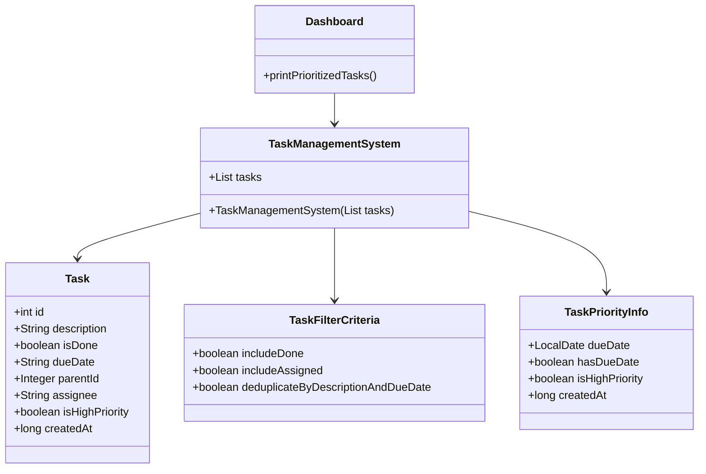
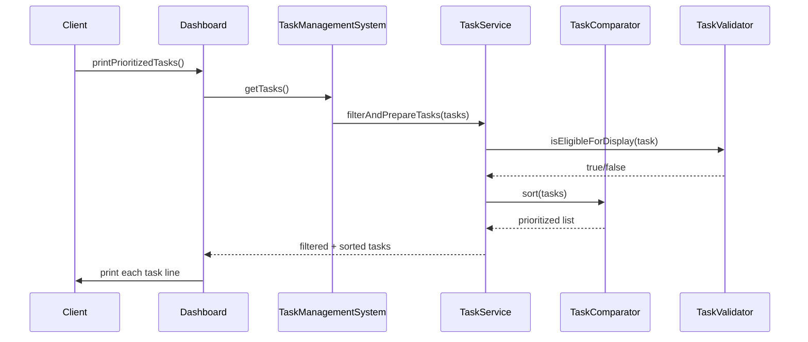

# Task Management System - High Level Design Plan

## 1) Problem Statement and Requirements

We are building a Java-based task management system that manages a collection of tasks and exposes a dashboard-oriented method: `printPrioritizedTasks`.

The system is initialized with a list of task objects. Each task contains:

- `id`: unique integer identifier
- `description`: task description
- `is_done`: completion flag
- `due_date`: ISO date string (`YYYY-MM-DD`) or null/empty
- `parent_id`: parent task id or `-1` / null
- `assignee`: assigned user or empty / null
- `is_high_priority`: priority flag
- `created_at`: Unix timestamp in seconds

Business requirements:

- Only include tasks that are:
  - not done
  - unassigned
  - not duplicates based on same description + due date
- Print tasks in the order a user should complete them.
- Format for each printed item:
  - `Task ID: {id}, Description: {description}`
  - If the task has a parent, append `, parent: {parent_task_description}`
- Prioritization rules:
  1. Earliest due date first
  2. If due dates are missing or equal, prefer high priority tasks
  3. If same priority, prefer oldest tasks

Important technical constraints:

- Java implementation with good OOP structure
- Balanced design: not overly extensive, but structured enough for interview practice and maintainability
- Use enums where it improves clarity (for example, task status, comparison mode, sort direction, or task filtering states)
- Focus on model classes + business logic layer, leaving test layer for later stages

---

## 2) Status of Execution

Status: Step 1 completed.

- Repository created: `task-prioritizer-java`
- High-level design document created and ready for review
- Next expected action: review this plan and either request changes or continue to Step 2 (model classes)

Current milestone:

- [x] Repository initialization
- [x] High-level requirement capture
- [x] Domain model design overview
- [x] Business flow design overview
- [x] Folder structure proposal
- [x] Scope definition for model and business classes
- [ ] Review and approval from user
- [ ] Step 2: model class implementation
- [ ] Step 3: business logic implementation
- [ ] Step 4: unit tests

---

## 3) Model Class Diagram

The model layer will be intentionally compact but structured. We will keep one primary model class with nested static classes for clarity, as requested.



Notes:

- `Task` is the core entity.
- `TaskPriorityInfo` is a lightweight helper for sort and comparison logic.
- `TaskFilterCriteria` can be used to express the filtering intent without embedding logic directly in business objects.
- `Dashboard` is the access point that triggers `printPrioritizedTasks`.

---

## 4) Business Class Request Flow Sequence Flow Diagram



This sequence keeps the responsibilities separated:

- `Dashboard`: UI-facing entry point
- `TaskManagementSystem`: aggregate root / owned task collection
- `TaskService`: orchestration for filtering and prioritization
- `TaskValidator`: rule enforcement for task eligibility
- `TaskComparator`: ordering rules based on due date / priority / age

---

## 5) Folder Structure Diagram / Detail

We will keep the structure compact and simple.

```text
task-prioritizer-java/
├── README.md
├── docs/
│   └── task-management-system-plan.md
├── src/
│   └── main/
│       └── java/
│           └── com/
│               └── taskmanager/
│                   ├── model/
│                   │   └── Task.java
│                   ├── service/
│                   │   └── TaskPriorityService.java
│                   ├── dashboard/
│                   │   └── Dashboard.java
│                   ├── util/
│                   │   ├── TaskSortKey.java
│                   │   └── TaskFilterCriteria.java
│                   └── common/
│                       └── TaskStatus.java
├── src/
│   └── test/
│       └── java/
│           └── com/
│               └── taskmanager/
│                   └── TaskPriorityServiceTest.java
```

Folder responsibilities:

- `model`: domain entity definitions, including nested static classes if required
- `service`: business logic for filtering, sorting, and task preparation
- `dashboard`: presentation entry point with `printPrioritizedTasks`
- `util`: reusable criteria / support types
- `common`: enums for task states and business constants
- `test`: test cases for business rules, edge cases, and ordering

This is intentionally simple, but still clean enough to demonstrate OOP thinking and separation of concerns.

---

## 6) Model Classes with Their Details

### 6.1 Task

Purpose:

- Represents the task entity stored in the system.
- Encapsulates all domain attributes and basic data validity assumptions.

Fields:

- `id` (`int`)
- `description` (`String`)
- `isDone` (`boolean`)
- `dueDate` (`String` or `null`)
- `parentId` (`Integer` or `null`)
- `assignee` (`String` or `null`)
- `isHighPriority` (`boolean`)
- `createdAt` (`long`)

Possible behaviors:

- `hasParent()`
- `isAssigned()`
- `hasDueDate()`
- `isDone()`
- `isDuplicateOf(Task other)` (optional helper)
- `getParentDescription()` (maybe resolved through a lookup map)

Design note:

- For this exercise, we can keep a single model class using nested static classes where needed, as requested by the user.
- Since the user specifically prefers a single model class with nested required classes, the final implementation can be structured like:

```java
public class Task {
    private final int id;
    private final String description;
    private final boolean isDone;
    private final String dueDate;
    private final Integer parentId;
    private final String assignee;
    private final boolean isHighPriority;
    private final long createdAt;

    // nested classes if needed: TaskFilterCriteria, TaskPriorityInfo
}
```

### 6.2 TaskFilterCriteria

Purpose:

- Encapsulates the filtering rules in a reusable object.
- Makes the code readable and easier to test.

Fields:

- `includeDone` = false
- `includeAssigned` = false
- `deduplicateByDescriptionAndDueDate` = true

### 6.3 TaskPriorityInfo

Purpose:

- Converts a `Task` into sort-related metadata.
- Represents comparison fields without altering the actual task entity.

Fields:

- `LocalDate dueDate` or `null`
- `boolean hasDueDate`
- `boolean isHighPriority`
- `long createdAt`

### 6.4 Dashboard

Purpose:

- Presentation-facing class for human-readable output.
- Not responsible for business data decisions beyond calling the underlying service logic.

Role:

- `printPrioritizedTasks()` delegates business processing to the task service and prints results.

### 6.5 TaskManagementSystem

Purpose:

- Main domain aggregate that owns the task collection and acts as the system entry point.

Responsibilities:

- Store all tasks
- Expose tasks to dashboard and service layer
- Optional factory / initializer behavior for validation

---

## 7) Flow of Request for Each Operation We Will Implement in the Business Class

The business logic class will be a single class with nested helper classes if needed. We will keep it as a service-like orchestration object.

### 7.1 Operation: `printPrioritizedTasks()`

Flow:

1. Retrieve the task list from the task management system.
2. Normalize tasks if needed (null-safe conversion, missing values).
3. Filter tasks using business rules:
   - exclude done tasks
   - exclude assigned tasks
   - exclude duplicates by `(description, due_date)`
4. Build parent lookup map from parent tasks
5. Sort the filtered tasks by:
   - due date ascending
   - if no due date or equal due date, high priority first
   - if same priority, oldest first
6. Iterate sorted list and print lines in the required format
7. If a task has a parent ID, lookup and print parent description in the suffix

### 7.2 Operation: `filterTasks(List<Task>)`

Rules:

- Keep tasks where `!task.isDone()`
- Keep tasks where `task.getAssignee() == null || task.getAssignee().isBlank()`
- Exclude duplicates based on description + due date
- Keep tasks even if parent is missing or if due date is empty/null

### 7.3 Operation: `prioritizeTasks(List<Task>)`

Sort comparator flow:

- Compare due dates (null treated as latest / after real dates)
- If both date values are null or equal, compare priority
- If priority equal, compare `createdAt` ascending

### 7.4 Operation: `buildParentDescriptionMap()`

Purpose:

- Resolve each task’s parent description when needed for output.
- Helps keep the dashboard printing logic simple.

Implementation consideration:

- Use a map of `id -> description` built from task list.
- If parent task is not found, print nothing or skip suffix.

---

## 8) Business Classes Details

We will include a single business logic class, as requested, and keep support structures as inner static classes.

### 8.1 Main Business Class: `TaskPriorityService`

Responsibilities:

- validate tasks for inclusion
- deduplicate tasks
- sort tasks per prioritization requirement
- prepare render-ready output list

Methods (conceptual):

- `public List<Task> filterTasks(List<Task> tasks)`
- `public List<Task> prioritizeTasks(List<Task> tasks)`
- `public List<String> buildPrintableOutput(List<Task> tasks)`
- `public void printPrioritizedTasks()` (optional if dashboard delegates directly to service)

### 8.2 Nested Helper Classes

Possible nested classes:

- `TaskSortComparator implements Comparator<Task>`
- `TaskFilterCriteria` (if not using a separate utility class)
- `TaskDisplayRow` (optional if output formatting needs abstraction)

This approach helps satisfy the requirement to keep business logic in a single class while still preserving clean structure.

### 8.3 Enum Suggestions

Use enums sparingly but meaningfully:

- `SortField` -> `DUE_DATE`, `PRIORITY`, `CREATED_AT`
- `TaskState` -> `DONE`, `OPEN`, `UNASSIGNED`

These can help make comparisons and filtering easier to read and safer than using raw booleans or string checks.

### 8.4 OOP Principles to Emphasize

- Encapsulation: data and logic separated through model/service boundaries
- Single responsibility: filter logic, sort logic, and printing are distinct concerns
- Clear naming: descriptive methods like `isEligibleForDisplay`, `buildParentMap`, `sortByPriority`
- Minimal but useful abstraction: no over-engineering, but enough structure for maintainability and interview readiness

---

## 9) Test Case Details

We will create unit tests in later steps. Test cases will validate business logic and edge conditions.

### 9.1 Core Filtering Tests

1. `shouldExcludeDoneTasks`
   - Input includes a completed task
   - Expect it is not printed

2. `shouldExcludeAssignedTasks`
   - Input includes an assigned task
   - Expect it is not printed

3. `shouldRemoveDuplicateTasksByDescriptionAndDueDate`
   - Same description + same due date appears twice
   - Only one remains

4. `shouldKeepUnassignedOpenTask`
   - Valid task remains in the output

### 9.2 Priority Ordering Tests

5. `shouldSortByEarliestDueDate`
   - Tasks with earlier dates appear first

6. `shouldFavorHighPriorityWhenDatesAreMissingOrEqual`
   - Compare tasks with null / missing due date

7. `shouldFavorOlderTasksWhenPriorityAndDueDateMatch`
   - Same due date and same priority, older tasks come first

8. `shouldHandleMixedDueDateAndPriorityCases`
   - Validates overall ordering across all rules

### 9.3 Output Format Tests

9. `shouldPrintRequiredFormat`
   - Confirms exact output string format

10. `shouldAppendParentDescriptionWhenParentExists`
   - Validates suffix logic

11. `shouldNotAppendParentSuffixWhenNoParentExists`
   - Ensures optional output is not added incorrectly

### 9.4 Edge Cases

12. `shouldHandleNullParentId`
13. `shouldHandleBlankAssignee`
14. `shouldHandleNullDueDate`
15. `shouldHandleTasksWithNoParentMetadata`

---

## Summary

This design balances simplicity and good Java OOP practice:

- Clear domain model (`Task`)
- Business logic centralized in a single service class
- Dashboard as a presentation layer entry point
- Minimal helper structures using nested classes and enums where useful
- Enough abstraction to demonstrate sound engineering without overbuilding for an interview exercise

This plan is intentionally scoped for the next step: implementation of the model layer, which will follow after your review.
